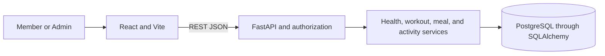

# Group 13 Project Specification

**Smart Nutrition and Fitness System · Draft 0.6 · 21 November 2026**

This document defines the shared scope, architecture, roles, and workflow. Each sprint document contains its stories, acceptance criteria, API/schema changes, tasks, tests, and work log. Member names follow the roster below. Task acknowledgements, reviewer availability, and deadlines still need to be recorded in the relevant issues.

## Document Map


| File                               | Contents                                                                | Current status                                                   |
| ---------------------------------- | ----------------------------------------------------------------------- | ---------------------------------------------------------------- |
| [PROJECT_SPEC.md](PROJECT_SPEC.md) | Shared goals, scope, architecture, and collaboration workflow           | Shared draft                                                     |
| [SPRINT_1.md](sprints/SPRINT_1.md) | Accounts, profiles, measurements, BMI/TDEE, history, and administration | Measurement/BMI demo and TDEE helper available; integration pending |
| [SPRINT_2.md](sprints/SPRINT_2.md) | Exercise catalog, workout plans, completion, and streaks                | Proposed for refinement, implementation pending                  |
| [SPRINT_3.md](sprints/SPRINT_3.md) | Vietnamese foods, meal suggestions, integration, and release            | Proposed for refinement, implementation pending                  |

**Where to update information** — Update shared scope, architecture, and workflow here. Update story details and rules in the sprint that owns them. Later tasks should reference the original rule ID and document when reusing a rule.

**Starting Sprint 1:** each member reads their [first action](sprints/SPRINT_1.md#first-action-for-each-member), then the [implementation checklist](sprints/SPRINT_1.md#implementation-checklists) for their task. Tuấn Anh and the reviewers should also read the [database deliverables](sprints/SPRINT_1.md#database-deliverables-for-s1-03) before implementing S1-03.

## Product Goal

The web application lets Members save profiles and body measurements, view BMI and estimated energy expenditure, obtain workout plans and Vietnamese meal suggestions, and record completion to track habits. Admins manage accounts, exercises, and foods.


| User   | Goal                                                    |
| ------ | ------------------------------------------------------- |
| Member | Manage personal data, view plans, and record activities |
| Admin  | Manage accounts and catalog data                        |

Indicator calculations, plan selection, and streak updates are automated behavior inside the application. Actor definitions in use-case diagrams should match the team's system boundary.

## Scope and Delivery Plan


| Stage            | Expected demonstration                                                    | Planning reference                  |
| ---------------- | ------------------------------------------------------------------------- | ----------------------------------- |
| Sprint 1         | Members use accounts and health tracking, Admins manage accounts          | WBS 1.1–1.9                        |
| Sprint 2         | Goal → workout plan → completion → streak                              | WBS 2.1–2.8                        |
| Sprint 3         | Vietnamese meal suggestions → meal logging → integrated flow on staging | WBS 3.1–3.7                        |
| Final acceptance | UAT, defect fixes, handover documents, and presentation                   | WBS 4.1–4.2, checklist in Sprint 3 |

Challenges await D-04 because the project description and plan differ. The current scope excludes Maps, food ordering, wearables, payments, social networking, medical diagnosis, and AI/LLM-generated plans.

The team must enter actual sprint dates and the submission deadline. The original plan uses course weeks 9–16. Record the revised schedule before committing to tasks.

## Roles and Responsibilities

Member names were entered in this main specification and synchronized on 20 November 2026. This table is the source for names and role codes in the sprint specifications, execution guide, beginner PDF, Agile plan, and tool checklist. Keep A–F as stable role codes; show names in task assignments. Each owner acknowledges their task in its issue; reviewers confirm availability there. Everyone tests their own work and obtains another member's review before marking it complete.


| Role | Name         | Responsibility                             | Sprint 1 support                                                     |
| ---- | ------------ | ------------------------------------------ | -------------------------------------------------------------------- |
| A    | Tá Anh       | Requirements, profiles, BMI/TDEE           | Finalize acceptance criteria, formulas, and hand-calculated examples |
| B | Tuấn Anh | Backend, database, authentication | Design users/profiles/sessions, migrations, and ownership checks |
| C | Bảo | Interface and integration | Figma, forms, login screens, dashboard, and charts |
| D | Đạt | Sprint 2 workout module | Review edge cases, API tests, and access to other accounts' records |
| E | Thắng | Sprint 3 meal module | Review profile inputs, try user journeys, and prepare sourced data |
| F | Hưng | Setup, CI, deployment, and browser testing | Run on a second machine, retain CI links, and coordinate the demo |

AI supports the assigned member. Every task has a person responsible for explaining and verifying its result. The initial code was created with AI assistance. The team has yet to confirm attribution of implementation contributions to A–F.

## Architecture and Tools




| Area                          | Tools and status                                                                                   |
| ----------------------------- | -------------------------------------------------------------------------------------------------- |
| Frontend                      | React + Vite, JavaScript, CSS, measurement form and history table available                        |
| Backend/API                   | Python + FastAPI + Pydantic, REST/JSON, Swagger UI                                                 |
| Database                      | PostgreSQL, SQLAlchemy models, Alembic migrations                                                  |
| Testing and CI                | pytest + FastAPI TestClient, successful GitHub Actions runs                                        |
| Additional design and testing | Figma, diagrams.net, and Playwright according to sprint tasks                                      |
| Startup and hosting           | Windows local script available. Docker Compose and staging require implementation and verification |

The code baseline `7e0f064` contains a shared measurement/BMI demo and 12 test cases. Sprint 1 documents the existing API/schema and planned additions. Installation and startup instructions are in the [README](../README.md).

## Open Decisions


| ID | Question or proposal | Owner | Status | Decision and date |
| ---- | ------------------------------------------------------------------------------------------------------------------------------------------------------------ | ---------- | ---------------------------------------- | ----------------- |
| D-01 | Confirm Sprint 1 scope and review date with the instructor | Tá Anh | Awaiting confirmation | To be filled |
| D-02 | Select the TDEE equation, source, and activity factors. Review the [S1-07 proposal and integration handover](handover/S1-07_HEALTH_HANDOVER.md). | Tá Anh | Sourced implementation proposed; team decision pending | No approval recorded; review equation, activity codes, age scope, and input rules |
| D-03 | Define valid emails/passwords, hashing library, session lifetime, cookies/CSRF, and initial Admin provisioning. The tool checklist proposes server sessions. | Tuấn Anh | Awaiting design | To be filled |
| D-04 | Are challenges required? The project description and CSV differ. | Tá Anh | Awaiting instructor clarification | To be filled |
| D-05 | Agree on the display timezone and which saved data can be edited | Tá Anh + Bảo | Awaiting team decision | To be filled |
| D-06 | Select staging hosting, PostgreSQL requirements, and setup on other machines | Hưng | Awaiting access checks | To be filled |
| D-07 | Names are recorded; confirm individual task owners, reviewers, and deadlines | Whole team | Names recorded; task acknowledgements pending | Roster synchronized 20 November 2026; task reviews pending |

When changing a rule, record the decision ID, reason, affected stories/API/schema/tests, decision maker, and date. Update the specification in the pull request implementing the change.

Workout/streak and meal decisions have separate tables in Sprints 2 and 3. Record decisions affecting multiple sprints here and link from the affected sprint documents. Retain existing IDs when renaming or moving content.

## Definition of Done

Acceptance criteria (AC) define verifiable outcomes for each story. Implementation and technical tasks link to their verification results.

- [ ]  All acceptance criteria for the story or task have been checked.
- [ ]  Relevant tests pass, with the commit, command, result, or CI run recorded.
- [ ]  Another person has reviewed the work and recorded their name and conclusion in the PR or log.
- [ ]  The interface, API, and database work together for the relevant flow.
- [ ]  The specification, API/migrations, and instructions reflect applicable changes.
- [ ]  Member contributions and AI assistance accurately describe the work performed.

Use **Not started → In progress → In review → Done**. When using **Blocked**, record the question/error, person needed, and next diagnostic step. Assess progress using acceptance criteria and evidence. Planning tasks can finish while a software story remains in progress.

## Member and AI Workflow

Follow the [Git workflow guide](GIT_WORKFLOW.md) for commands, pull requests, review, merging, and conflict handling.

1. Take a task with an owner, reviewer, and expected outcome. Create or link its issue.
2. Read the main specification, sprint specification, acceptance criteria, and relevant decisions. Gather the necessary code and files.
3. Work on a task branch. Record assumptions and questions as they arise.
4. Verify each step. Update the relevant sprint log with actual results.
5. Open a PR linking the task/story, changes, tests, and points requiring review.
6. Obtain another member's review. Update status and evidence when the acceptance criteria and Definition of Done are met.

The team should agree on this proposed workflow. Members take responsibility for results obtained with AI and can explain their verification. Use fictional data in prompts and logs, removing credentials before sharing.

### Shared AI Prompt

```text
You are supporting Group 13's Smart Nutrition and Fitness project.
Read docs/PROJECT_SPEC.md and docs/sprints/SPRINT_[1|2|3].md.
Member: [name, role A–F]
Task / story / issue: [ID and link]
Starting commit: [commit]
Goal for this session: [one outcome]
Relevant acceptance criteria and decisions: [IDs and details]
Code, attempted commands, and errors: [relevant context]

Explain briefly and propose one small step with a way to verify it.
State assumptions and missing decisions that affect the current step.
At handover, record changed files, AI assistance, what the member verified,
commands executed, actual results, and the next step.
Use the sprint log template. Mark completion against evidenced criteria.
```

When switching AI tools or handing work to another person, provide the commit, task, completed work, test results, and blockers. The specifications provide shared context. Members and AI update logs for each session and compare them with commits/PRs to verify progress.

## Immediate Team Actions


| Priority | Next action                                                                                  | Verifiable outcome                                                         |
| -------- | -------------------------------------------------------------------------------------------- | -------------------------------------------------------------------------- |
| 1 | Acknowledge the named task assignments, set review dates, and confirm the remaining schedule | Every task has a confirmed owner, reviewer, and deadline |
| 2 | Check repository access for all six members and create/reconcile GitHub Issues and the board | Every active task has an issue and an accurate status |
| 3 | Each member runs the demo on their own machine | The log names the tester, tool versions, and actual result or error |
| 4 | Finalize authentication and the TDEE formula alongside Figma/ERD work | D-02/D-03 have decisions and verification examples |
| 5 | Implement authentication and ownership, then complete Sprint 1 | Story criteria link to tests, PRs, and reviews |
| 6 | Start collecting exercise and food data early | Data templates include units, sources, reviewers, and trial import batches |
| 7 | Select and test staging early | Record its URL, deployment steps, and persistence checks after restart |

## Revision History and Sources


| Version | Date             | Change                                                                              | Confirmation                     |
| ------- | ---------------- | ----------------------------------------------------------------------------------- | -------------------------------- |
| 0.1     | 19 November 2026 | Initial combined Sprint 1 and shared workflow specification                         | Draft prepared with AI           |
| 0.2     | 19 November 2026 | Split the main and three sprint specifications, retaining Sprint 1 IDs and evidence | Draft awaiting team confirmation |
| 0.3     | 19 November 2026 | Translate repository documentation into English and update navigation links         | Translation awaiting team review |
| 0.4 | 20 November 2026 | Synchronize the roster across sprint assignments and planning artifacts | Names supplied by the user; task acknowledgements and reviews pending |
| 0.5 | 21 November 2026 | Link the sourced S1-07 TDEE proposal and integration handover | D-02 awaits team review; API/UI integration pending |
| 0.6 | 21 November 2026 | Link actionable Sprint 1 member/task checklists and database handoff requirements | Documentation clarified; task completion still requires verification/review |

References include `Project Description.docx`, the Group 13 Agile workbook (`Sprint_Agile_Group13 1.xlsx`, converted from the original CSV), the project execution guide, the tool checklist, and repository code. Sprints 2 and 3 expand their corresponding WBS entries as proposals. The team confirms new algorithms, limits, and dates in the decision tables.
