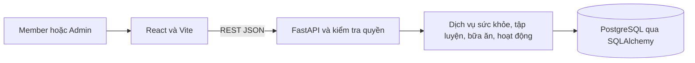

# Đặc tả tổng dự án Group 13

**Smart Nutrition and Fitness System · Bản nháp 0.2 · 19/11/2026**

File này giữ phạm vi, kiến trúc, vai trò và quy trình dùng chung. Mỗi sprint giữ story, AC, API/schema thay đổi, task, kiểm thử và nhật ký riêng. Phân công và thời hạn trong tài liệu đang chờ nhóm xác nhận.

## Bản đồ tài liệu

| File | Nội dung | Trạng thái hiện tại |
| --- | --- | --- |
| [PROJECT_SPEC.md](PROJECT_SPEC.md) | Mục tiêu, phạm vi, kiến trúc và cách phối hợp chung | Đang dùng làm bản nháp chung |
| [SPRINT_1.md](sprints/SPRINT_1.md) | Tài khoản, hồ sơ, số đo, BMI/TDEE, lịch sử và admin | Có demo số đo/BMI, chưa đạt đầy đủ AC |
| [SPRINT_2.md](sprints/SPRINT_2.md) | Danh mục bài tập, kế hoạch tập, hoàn thành và streak | Đề xuất để refinement, chưa triển khai |
| [SPRINT_3.md](sprints/SPRINT_3.md) | Món Việt, gợi ý bữa ăn, tích hợp và phát hành | Đề xuất để refinement, chưa triển khai |

**Cách chọn nơi cập nhật** — Sửa phạm vi/kiến trúc/quy trình chung tại đây. Sửa chi tiết story và rule tại sprint sở hữu nó. Task sau gọi lại mã rule trước đó khi tái sử dụng, rồi liên kết tới file gốc.

## Mục tiêu sản phẩm

Ứng dụng web giúp Member lưu hồ sơ và số đo, xem BMI và năng lượng tiêu hao ước tính, nhận kế hoạch tập và gợi ý món Việt, rồi ghi nhận hoàn thành để theo dõi thói quen. Admin quản lý tài khoản, bài tập và thực phẩm.

| Người sử dụng | Mục tiêu |
| --- | --- |
| Member | Quản lý dữ liệu cá nhân, xem kế hoạch và ghi nhận hoạt động |
| Admin | Quản lý tài khoản và dữ liệu danh mục |

Tính chỉ số, chọn kế hoạch và cập nhật streak là hành vi tự động bên trong ứng dụng. Định nghĩa actor trong sơ đồ use case cần nhất quán với ranh giới hệ thống nhóm vẽ.

## Phạm vi và kế hoạch

| Giai đoạn | Kết quả cần trình bày | Nguồn kế hoạch |
| --- | --- | --- |
| Sprint 1 | Member dùng tài khoản và theo dõi sức khỏe, Admin quản lý tài khoản | WBS 1.1–1.9 |
| Sprint 2 | Mục tiêu → kế hoạch tập → hoàn thành → streak | WBS 2.1–2.8 |
| Sprint 3 | Gợi ý món Việt → ghi nhận bữa ăn → luồng tích hợp trên staging | WBS 3.1–3.7 |
| Nghiệm thu cuối | UAT, sửa lỗi, tài liệu bàn giao và báo cáo | WBS 4.1–4.2, checklist trong Sprint 3 |

Challenge chờ xác nhận D-04 vì mô tả dự án và kế hoạch đang khác nhau. Phạm vi hiện tại loại các tích hợp Maps, đặt đồ ăn, thiết bị đeo, thanh toán, mạng xã hội, chẩn đoán y tế và AI/LLM tạo kế hoạch.

Ngày bắt đầu/kết thúc từng sprint và hạn nộp cuối cần nhóm điền theo lịch thực tế. Kế hoạch cũ dùng tuần học 9–16. Nhóm ghi rõ lịch điều chỉnh trước khi cam kết công việc.

## Vai trò và trách nhiệm

Đây là phân công đề xuất. Người được giao xác nhận nhận việc trên issue. Mọi người kiểm thử phần mình làm và có người khác review thay đổi trước khi ghi hoàn thành.


| Vai trò | Tên         | Trách nhiệm                                             | Việc hỗ trợ trong Sprint 1                                                         |
| -------- | ------------ | --------------------------------------------------------- | ------------------------------------------------------------------------------------- |
| A        | Chưa điền | Yêu cầu, hồ sơ, BMI/TDEE                              | Chốt AC, công thức và ví dụ tính tay                                           |
| B        | Chưa điền | Backend, database, auth                                   | Thiết kế user/profile/session, migration và quyền sở hữu                        |
| C        | Chưa điền | Giao diện và tích hợp                                 | Figma, form, màn hình đăng nhập, dashboard và biểu đồ                        |
| D        | Chưa điền | Module tập luyện của Sprint 2                          | Review ca biên và kiểm thử API, kiểm tra truy cập chéo tài khoản             |
| E        | Chưa điền | Module bữa ăn của Sprint 3                             | Review đầu vào hồ sơ, thử luồng người dùng, chuẩn bị dữ liệu có nguồn |
| F        | Chưa điền | Cách chạy, CI, triển khai và kiểm thử trình duyệt | Chạy máy thứ hai, giữ liên kết CI và tổng hợp kịch bản demo                |

AI là công cụ hỗ trợ cho người nhận task. Mỗi task vẫn có thành viên chịu trách nhiệm giải thích và kiểm tra kết quả. Code khởi tạo đã có hỗ trợ AI, và chưa được ghi nhận là đóng góp triển khai riêng của một thành viên A–F.

## Kiến trúc và công cụ



| Phần | Công cụ và tình trạng |
| --- | --- |
| Frontend | React + Vite, JavaScript, CSS, đã có form và bảng lịch sử |
| Backend/API | Python + FastAPI + Pydantic, REST/JSON, Swagger UI |
| Database | PostgreSQL, model SQLAlchemy, migration Alembic |
| Kiểm thử và CI | pytest + FastAPI TestClient, GitHub Actions đã chạy thành công |
| Thiết kế và kiểm thử bổ sung | Figma, diagrams.net, Playwright theo task từng sprint |
| Cách chạy/hosting | Có script Windows local. Docker Compose và staging cần triển khai, kiểm chứng theo task |

Code đối chiếu tại `7e0f064` có demo số đo/BMI dùng dữ liệu chung và 12 trường hợp test. Các API/schema đã có và phần cần bổ sung được ghi trong Sprint 1. Hướng dẫn cài/chạy ở [README](../README.md).

## Quyết định cần chốt

| Mã  | Câu hỏi và đề xuất                                                                                                                                         | Người theo dõi | Trạng thái                     | Kết luận và ngày chốt |
| ---- | ---------------------------------------------------------------------------------------------------------------------------------------------------------------- | ----------------- | -------------------------------- | -------------------------- |
| D-01 | Xác nhận phạm vi và ngày review Sprint 1 với giảng viên                                                                                                  | A                 | Chờ xác nhận                  | Chưa điền               |
| D-02 | Chọn công thức TDEE, nguồn và hệ số hoạt động. Kế hoạch gợi ý Mifflin–St Jeor.                                                                    | A                 | Chờ tìm nguồn và nhóm chốt | Chưa điền               |
| D-03 | Xác định email/mật khẩu hợp lệ, thư viện hash, thời hạn phiên, cookie/CSRF và cách cấp Admin ban đầu. Định hướng server session theo Excel. | B                 | Chờ thiết kế                  | Chưa điền               |
| D-04 | Challenge có bắt buộc không? Mô tả dự án và CSV đang khác nhau.                                                                                       | A                 | Chờ hỏi giảng viên           | Chưa điền               |
| D-05 | Chốt múi giờ hiển thị và dữ liệu nào được sửa sau khi lưu                                                                                          | A + C             | Chờ nhóm chốt                 | Chưa điền               |
| D-06 | Chọn nơi staging, điều kiện PostgreSQL và cách chạy trên máy khác                                                                                     | F                 | Chờ kiểm tra quyền truy cập  | Chưa điền               |
| D-07 | Điền tên thật cho A–F, xác nhận chủ task và người review                                                                                              | Cả nhóm         | Chờ họp                        | Chưa điền               |

Khi sửa quy tắc, ghi mã quyết định, lý do, story/API/schema/test bị ảnh hưởng, người chốt và ngày. Cập nhật spec cùng pull request thực hiện thay đổi đó.

Quy tắc workout/streak và meal có bảng quyết định riêng tại Sprint 2/3. Nếu quyết định ảnh hưởng nhiều sprint, ghi tại đây và liên kết từ các sprint liên quan. Giữ mã cũ khi đổi tên hoặc chuyển vị trí tài liệu.

## Điều kiện hoàn thành

AC là điều kiện nghiệm thu của từng story. Task triển khai và task kỹ thuật cần liên kết tới kết quả kiểm tra tương ứng.

- [ ]  AC của story hoặc task đã được kiểm tra đầy đủ.
- [ ]  Test liên quan đạt và ghi rõ commit, lệnh, kết quả hoặc CI run.
- [ ]  Người khác đã review và ghi tên/kết luận trong PR hoặc nhật ký.
- [ ]  UI, API và database hoạt động cùng nhau cho luồng liên quan.
- [ ]  Spec, API/migration và hướng dẫn được cập nhật khi có thay đổi.
- [ ]  Đóng góp của thành viên và AI được ghi đúng mức đã thực hiện.

Trạng thái chung dùng **Chưa làm → Đang làm → Chờ review → Hoàn thành**. Khi dùng **Bị chặn**, ghi câu hỏi/lỗi, người cần hỗ trợ và bước kiểm tra tiếp theo. Đánh giá tiến độ theo AC và bằng chứng. Các task lập kế hoạch có thể hoàn thành riêng trong khi story phần mềm còn đang làm.

## Quy trình thành viên và AI

1. Nhận một task có chủ việc, reviewer và kết quả mong đợi. Tạo issue hoặc liên kết issue đã có.
2. Đọc spec tổng, spec sprint, AC và quyết định liên quan. Chuẩn bị file/code cần dùng.
3. Làm trên nhánh theo task. Ghi lại giả định và câu hỏi phát sinh.
4. Kiểm tra từng bước. Cập nhật nhật ký tại sprint tương ứng với kết quả thực tế.
5. Mở PR liên kết task/story, thay đổi, test và điểm cần review.
6. Thành viên khác review. Khi đủ AC và Done, cập nhật trạng thái cùng bằng chứng.

Đây là quy trình đề xuất để nhóm chốt. Thành viên chịu trách nhiệm về kết quả đã dùng từ AI và giải thích được cách kiểm tra. Prompt và log dùng dữ liệu giả lập, bỏ thông tin đăng nhập trước khi chia sẻ.

### Prompt dùng chung

```text
Bạn hỗ trợ dự án Smart Nutrition and Fitness của Group 13.
Hãy đọc docs/PROJECT_SPEC.md và docs/sprints/SPRINT_[1|2|3].md.
Thành viên: [tên, vai trò A–F]
Task / story / issue: [mã, liên kết]
Commit bắt đầu: [commit]
Mục tiêu lần làm này: [một kết quả]
AC và quyết định liên quan: [mã và nội dung]
Code, lệnh đã thử và lỗi: [ngữ cảnh liên quan]

Giải thích ngắn và đề xuất một bước có cách kiểm tra.
Nêu giả định, quyết định còn thiếu nếu chúng ảnh hưởng bước đang làm.
Khi bàn giao, ghi file đã sửa, phần AI hỗ trợ, phần người phụ trách
đã kiểm tra, lệnh đã chạy, kết quả thực tế và bước tiếp theo.
Dùng mẫu nhật ký tại spec sprint. Chỉ ghi hoàn thành theo AC có bằng chứng.
```

Khi chuyển AI hoặc chuyển người làm, gửi lại commit, task, phần đã làm, kết quả test và blocker. Spec cung cấp ngữ cảnh chung. Thành viên và AI cập nhật log theo từng phiên, rồi đối chiếu với commit/PR để xác nhận tiến độ.

## Việc nhóm cần làm ngay

| Ưu tiên | Việc tiếp theo | Kết quả để kiểm tra |
| --- | --- | --- |
| 1 | Điền người A–F, ngày review và lịch còn lại | Mỗi task có người nhận, reviewer và hạn được xác nhận |
| 2 | Kiểm tra quyền repo của sáu người, tạo/đối chiếu GitHub Issues và board | Mỗi task đang làm có issue và trạng thái thực tế |
| 3 | Từng người chạy demo trên máy mình | Có người chạy, phiên bản công cụ, kết quả hoặc lỗi cụ thể trong log |
| 4 | Chốt auth và công thức TDEE song song với Figma/ERD | D-02/D-03 có kết luận và ví dụ kiểm tra |
| 5 | Làm auth, quyền sở hữu rồi hoàn thiện Sprint 1 | AC từng story có test, PR và review |
| 6 | Thu thập dữ liệu bài tập và món ăn từ sớm | Mẫu dữ liệu có đơn vị, nguồn, người review và batch nhập thử |
| 7 | Chọn và thử staging sớm | Có URL, cách deploy, kết quả kiểm tra dữ liệu tồn tại sau restart |

## Lịch sử tài liệu và nguồn

| Phiên bản | Ngày | Thay đổi | Xác nhận |
| --- | --- | --- | --- |
| 0.1 | 19/11/2026 | Spec ban đầu chứa Sprint 1 và quy trình chung | Bản nháp soạn với AI |
| 0.2 | 19/11/2026 | Tách spec tổng và ba sprint, giữ mã story/task và bằng chứng Sprint 1 | Bản nháp, chờ nhóm chốt |

Nguồn đối chiếu gồm `Project Description.docx`, kế hoạch CSV của Group 13, hướng dẫn dự án, bảng lựa chọn công cụ và code trong repo. Sprint 2/3 là đề xuất chi tiết hóa từ WBS tương ứng. Những thuật toán, giới hạn và lịch mới cần nhóm xác nhận tại bảng quyết định.
