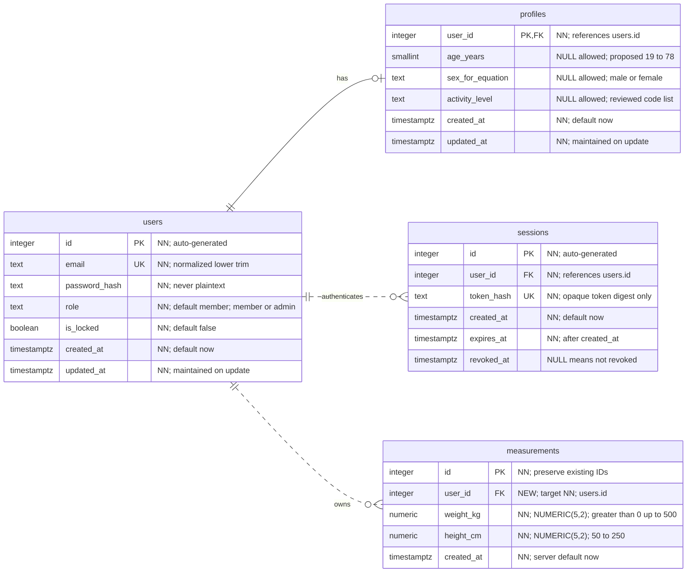

# Sprint 1 Detailed ERD

**21 November 2026 · Proposed target schema · Team review pending**

[Open the editable Figma design](https://www.figma.com/design/PeCVNPvqxn1UOfWI806p8F/Group-13---Sprint-1-Detailed-ERD?node-id=2-2) · [Mermaid source](SPRINT_1_ERD.mmd) · [Sprint 1 requirements](../sprints/SPRINT_1.md) · [Health calculation handover](../handover/S1-07_HEALTH_HANDOVER.md)

This design covers Sprint 1 accounts, profiles, sessions, and measurements. It is a proposal for S1-03, not the current physical schema or approval of D-02/D-03. Creating this diagram does not apply a migration or implement an API.

## Relationship Diagram

The diagram below matches [the Mermaid source](SPRINT_1_ERD.mmd). Read the field descriptions and pending decisions below before implementation.

## Existing and Proposed Structures

- Existing: `measurements.id`, `weight_kg`, `height_cm`, `created_at`, and the measurement-range constraints in `backend/models.py` and migration `001_measurements`.
- Proposed additions: `users`, `profiles`, `sessions`, and `measurements.user_id`.
- Proposed convention: integer identifiers compatible with existing measurement IDs; timestamps use PostgreSQL `TIMESTAMPTZ`. All new foreign keys use `ON DELETE RESTRICT` until an account-deletion policy is agreed. Sprint 1 uses lock/unlock and retains records.
- Future workout/meal/challenge structures are outside this Sprint 1 ERD. Alembic's migration-version table is infrastructure rather than a domain entity.

## Legend and Cardinalities

`PK`: primary key. `FK`: foreign key. `UK`: unique constraint. `NN`: not null. A field marked nullable can be absent in the database.

- One user has **zero or one profile**. Each profile belongs to exactly one user. `profiles.user_id` is both its PK and FK, enforcing at most one profile per account.
- One user has **zero or many sessions**. Each session belongs to exactly one user.
- One user has **zero or many measurements**. Each measurement belongs to exactly one user in the target schema.
- The profile relation is identifying because the parent key is the child's PK. Session/measurement relations are non-identifying because each child has its own PK; their user foreign keys are still mandatory.

## users

- `id INTEGER`: PK, NN, auto-generated. Other domain tables reference this value.
- `email TEXT`: NN, UK. Proposed normalization is lowercasing and trimming before storage, with a matching database check. Exact accepted email syntax/normalization belongs to D-03.
- `password_hash TEXT`: NN. Store the result of the maintained hashing library agreed under D-03. Never store or return plaintext passwords.
- `role TEXT`: NN, default `member`, proposed CHECK in `member`, `admin`. Registration creates `member`; initial Admin creation is a separate controlled operation.
- `is_locked BOOLEAN`: NN, default false. Authorization checks account status on protected requests, including requests using old sessions.
- `created_at TIMESTAMPTZ`: NN, default `now()`.
- `updated_at TIMESTAMPTZ`: NN, default `now()` on insert; update explicitly in the application or an agreed trigger. The default alone does not update this field when another column changes.

The unique email constraint supplies its lookup index. Do not expose password hashes or session-token data in account-list responses.

## profiles

- `user_id INTEGER`: PK, FK, NN, references `users.id`.
- `age_years SMALLINT`: nullable; proposed CHECK 19 through 78 inclusive when present, matching the sample helper. This is the proposal's calculation scope, not a medical-suitability claim. The team must confirm age storage/update policy; birth-date storage would require an agreed age-at-calculation rule.
- `sex_for_equation TEXT`: nullable; proposed CHECK `male` or `female` when present. This chooses a published equation coefficient. Do not infer it from a name or default an unsupported value to another category.
- `activity_level TEXT`: nullable; proposed CHECK in the reviewed codes below when present.
- `created_at TIMESTAMPTZ`: NN, default `now()`.
- `updated_at TIMESTAMPTZ`: NN, default on insert, explicitly maintained on update.

Absent/incomplete profiles are permitted so an account can exist before calculation inputs are supplied. The API reports missing inputs and leaves TDEE unavailable until all required values exist. Weight/height remain in measurement history and are not duplicated in the profile.

The current helper proposal maps `sedentary` to 1.2, `lightly_active` to 1.375, `moderately_active` to 1.55, `active` to 1.725, and `very_active` to 1.9. Review these under D-02. The backend owns the mapping; the client submits a code rather than an arbitrary multiplier. A separate lookup table is not needed for this proposed fixed code list.

## sessions

- `id INTEGER`: PK, NN, auto-generated, an internal row ID rather than an authentication secret.
- `user_id INTEGER`: FK, NN, references `users.id`.
- `token_hash TEXT`: NN, UK, a digest of an opaque random session token. The raw token is not stored in this table. Token generation, digest format, cookie/CSRF handling, and expiry duration require D-03 review.
- `created_at TIMESTAMPTZ`: NN, default `now()`.
- `expires_at TIMESTAMPTZ`: NN, CHECK greater than `created_at`.
- `revoked_at TIMESTAMPTZ`: nullable, CHECK null or greater than/equal to `created_at`.

Add an index on `sessions(user_id)` for account-wide session handling. The unique token-hash constraint supports lookup. A session is usable only if not revoked, not expired at request time, and its account is unlocked. Those request-time conditions are backend logic, not supplied by a foreign key or a timestamp column alone.

Logout must revoke the current session by setting `revoked_at`. Locking an account must revoke its existing sessions as well as set `users.is_locked`; perform those changes atomically. Unlocking must not clear prior revocations or restore old tokens. The member must log in again to obtain a new session.

## measurements

- `id INTEGER`: existing PK and generated-ID behavior. Preserve current IDs/defaults during upgrade.
- `user_id INTEGER`: new FK to `users.id`, NN in the final target schema. Existing ownerless records need an explicitly agreed conversion before enforcing this requirement.
- `weight_kg NUMERIC(5,2)`: NN, existing CHECK greater than 0 and at most 500 kg.
- `height_cm NUMERIC(5,2)`: NN, existing CHECK 50 through 250 cm inclusive.
- `created_at TIMESTAMPTZ`: NN, server default `now()`. The server supplies the recording time.

Proposed history index: `measurements(user_id, created_at DESC, id DESC)`. Backend reads/writes must use authenticated identity; a foreign key does not stop an account from requesting another account's row.

BMI is calculated from each measurement. TDEE requires the selected measurement and the applicable profile under the agreed history policy. No BMI/TDEE result column or historical profile-snapshot structure is included in this proposal. Do not label a calculation using today's profile as the original historical TDEE estimate.

## Decisions Required Before Implementation

- **D-02:** accept/revise profile fields, age scope/update rule, equation values, activity mapping, measurement limits, and historical-profile/TDEE policy. The existing source/examples are linked in the health handover.
- **D-03:** accept/revise normalized email rules, password hashing library, opaque session/digest design, duration, cookie/CSRF settings, and initial Admin provisioning.
- **D-05:** confirm display timezone and permitted editing/deletion of saved data.
- **S1-03 conversion:** agree how to assign existing fictional measurements to a demo account or otherwise handle them while preserving required data. Do not make a destructive migration by assumption.

These pending decisions do not prevent review of the proposed relationships. They must be recorded before the dependent schema/API behavior is treated as agreed.

## Implementation and Review Handoff

1. Review the four tables, fields, and cardinalities with the group; record D-02/D-03/D-05 outcomes.
2. Extend SQLAlchemy models and add a new Alembic migration. Keep the existing applied migration intact.
3. Implement and test the ownerless-record conversion before enforcing measurement ownership.
4. Verify clean database creation and upgrade against isolated test data, preserving IDs, values, and ownership.
5. Add repeatable fictional data setup, then authenticated APIs and own-account/role/session tests.
6. Ask the assigned reviewer to check both the schema and actual migration evidence. An ERD alone does not complete S1-03.

No application code, migrations, live database contents, or team approval are changed by these design files.
